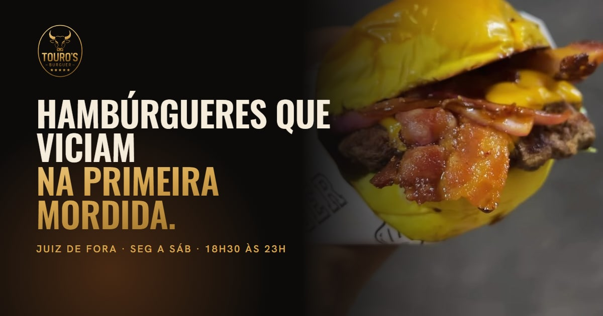

<p align="center">
  
</p>

<p align="center">
  
  
  
  
  
  
</p>

# Touro’s Burguer

**No ar:** https://tourosburguer.abramdigital.com.br

Site do **Touro’s Burguer**, hamburgueria artesanal em Juiz de Fora (MG) —
*hambúrgueres que viciam na primeira mordida*. Segunda a sábado, 18h30 às 23h.

## O problema

A casa é nova e vende por dois caminhos: o iFood e o WhatsApp. O iFood
funciona, mas o cardápio da casa vive numa arte de Instagram — não é
indexável, não soma, e quem pede pelo WhatsApp digita "um bacon cheddar sem
cebola com mais bacon" e espera a conta. E o que a casa tem de melhor — os
reels da cozinha, a montagem na mão — fica no Instagram, longe de quem busca
"hambúrguer Juiz de Fora".

O site resolve as três coisas: cardápio em HTML indexável, com preço; uma
sacola que monta o lanche **do jeito da pessoa** (adicionais e "sem") e manda
a mensagem pronta e somada para o WhatsApp; e a prova, em vídeo, da chapa.

## Decisões

### Um lanche é uma lista de camadas

`src/lib/camadas.ts` descreve cada lanche do cardápio de baixo para cima —
pão, alface, tomate, blend, cheddar, bacon, cebola, pão. A mesma lista vira:

- o **desenho em corte** (`Corte.tsx`), que troca de lanche com animação no
  seletor dos artesanais e **cresce ao vivo** no painel "Do meu jeito" a cada
  adicional;
- a **cena 3D** da anatomia, que abre o Bacon Cheddar camada por camada com a
  rolagem;
- a **mensagem de WhatsApp**, com cada adicional e cada "sem".

O desenho mostra exatamente o que a cozinha recebe — não há como divergir.

### A sacola faz a conta em centavos

`3 × 2,90` em ponto flutuante é `8,700000000000001`. `src/lib/pedido.ts` soma
em centavos inteiros, normaliza cada escolha (adicional desconhecido, "sem"
que o lanche não permite, adicional em bebida — tudo descartado), e agrupa
escolhas idênticas numa linha independentemente da ordem do clique. O teste
percorre **todo lanche × todo adicional × 1 a 5 unidades**.

### O 3D é feito em código

Nenhum `.glb`: pão em torno (com a costura soldada), carne com borda
irregular, cheddar que derrete nas pontas, bacon ondulado, alface franzida,
brasas subindo. O canvas fica num palco `sticky` que atravessa o herói e a
anatomia; a rolagem vira dois números (entrada e abertura), e os rótulos são
HTML presos a cada camada pela projeção da câmera. Sem WebGL ou com movimento
reduzido, a anatomia vira o desenho em corte parado.

### Foto é foto real

A casa não tem ensaio fotográfico — tem reels em 1080p. `scripts/midia.mjs`
tira deles os quadros das fotos e os trechos de vídeo, declarando reel,
segundo e recorte de cada um. Lanche sem foto aparece com o desenho em corte,
nunca com a foto de outro.

### A marca veio do logo

O selo (touro, letreiro, estrelas) foi vetorizado com potrace a partir do logo
no cardápio oficial; o anel oval é uma elipse medida, porque no arquivo ele
tinha a textura do fundo por baixo. Favicon, ícones e as artes de
compartilhamento saem do vetor (`npm run brand`).

## Rodando

```bash
npm install
npm run dev
```

| Comando | O que faz |
|---|---|
| `npm run build` | build de produção (um HTML por rota, JSON-LD, sitemap, llms.txt) |
| `npm run test` / `test:cov` | testes unitários (Vitest) |
| `npm run e2e` | ponta a ponta contra o build (Playwright, desktop e celular) |
| `npm run midia` | fotos e vídeos a partir dos reels (precisa de ffmpeg) |
| `npm run assets` | converte as fotos para AVIF/WebP |
| `npm run brand` | favicon, ícones e artes de compartilhamento |
| `npm run fonts` | baixa as fontes (Oswald, Hanken Grotesk, JetBrains Mono) |

Instruções para quem for mexer no código — gente ou agente — em
[`AGENTS.md`](AGENTS.md). Publicação em [`DEPLOY.md`](DEPLOY.md).

## Infraestrutura

```
 visitante ──HTTPS──▶ Cloudflare (proxy) ── TLS, HTTP/3, cabeçalhos de segurança,
                          │                   /rota → /rota/index.html
                          │ HTTP
                          ▼
                    S3 static website  (bucket = domínio; só aceita os IPs da Cloudflare)
                          ▲
 GitHub Actions ── OIDC ──┘  credencial temporária de 1 h — sem access key em lugar nenhum
```

Push na `main` → lint, testes, build, publicação no S3 e smoke test no ar
(ver [`DEPLOY.md`](DEPLOY.md)).

## Licença e crédito

O **código** está sob a licença [MIT](LICENSE). A marca, as fotos, os vídeos e
os textos pertencem a **Touro's Burguer** — todos os direitos reservados; não podem
ser reutilizados sem autorização.

Desenvolvido por [Felipe Neiva](https://github.com/ffneiva) ·
[Abram Digital](https://abramdigital.com.br).
